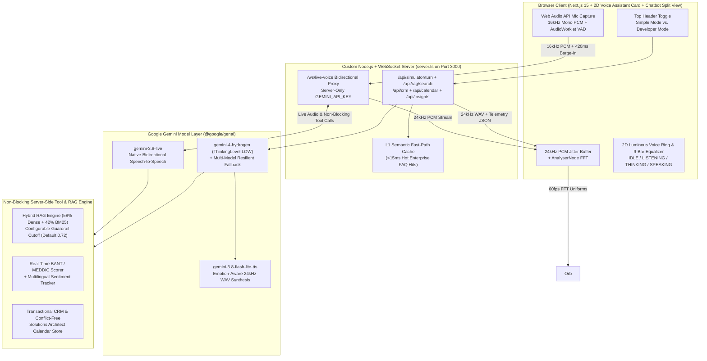

# AetherCloud Voice SDR — Autonomous AI Sales Voice & Chat Agent (Project 1)

**AetherCloud Voice SDR** is a production-grade, real-time autonomous AI sales voice and chat agent built on the **Google Gemini Live API (`gemini-3.8-live`)**, **Gemini Orchestration (`gemini-4-hydrogen` / `gemini-2.5-flash`)**, **Gemini 3.8 Speech Synthesis (`gemini-3.8-flash-lite-tts`)**, **Next.js 15 App Router**, a **Custom Node/WebSocket Audio Bridge (`server.ts`)**, and a high-whitespace **2D Voice Assistant Card & Chatbot Split View** set in **Plus Jakarta Sans** and **DM Sans**.

It is designed around two progressive operating modes accessible via a single top-header toggle:
- **Simple Mode (Everyday Users & Sales Prospects)**: A clean, distraction-free **shadcn/ui Light Theme** workspace (`#FAF8F5` warm alabaster canvas) pairing a **2D Voice Assistant Card** on the left (luminous 2D voice ring, voice persona selector, greeting headline, 9-bar live audio equalizer waveform, 1-click guided demo bar, and microphone controls) with a spacious **Chatbot Conversation & Quick Actions Panel** on the right.
- **Developer Mode (AI Systems Engineers & Evaluators)**: Unlocks live tuning controls for **RAG Confidence Cutoff (`0.50`–`0.95`)**, **Top-K Retrieval (`1`–`5`)**, **Client-Side AudioWorklet VAD Barge-In RMS Sensitivity (`0.010`–`0.060`)**, **Voice Persona (`Zephyr`, `Kore`, `Puck`, `Charon`, `Fenrir`)**, **Raw JSON Tool & Citation Payload Inspection**, an **Out-of-Scope Anti-Hallucination Guardrail Tester**, and deep-dive tabs for **Knowledge Base**, **Meetings & Customers**, and **Architecture & Scale**.

---

## 1. End-to-End System Architecture Diagram



---

## 2. System Design Choices, Architectural Trade-Offs & Rationale

### Decision 1: Custom Node.js WebSocket Audio Bridge (`server.ts`) vs. Browser-Direct SDK Connection
- **Choice Made**: All Gemini Live API (`ai.live.connect`) and REST (`ai.models.generateContent`) sessions terminate on the Node.js server (`server.ts` and `/app/api/*`) using `process.env.GEMINI_API_KEY`. The browser communicates with the server over a local WebSocket (`/ws/live-voice`) and JSON REST routes.
- **Trade-Off**: Adds ~2–4 ms of local WebSocket relay overhead compared to connecting directly from the browser.
- **Why We Made It**:
  1. **Zero Credential Exposure**: Keeps `GEMINI_API_KEY` strictly server-side (`process.env`), preventing key leakage in client bundles or browser DevTools.
  2. **Unified Server-Side State**: Allows non-blocking tool calls (`search_knowledge_base`, `update_bant_qualification`, `book_sales_appointment`) executed during a live voice call to immediately mutate the same server-side CRM, Calendar, and RAG state inspected in the UI.

### Decision 2: Hybrid Dense (58%) + BM25 Lexical (42%) RAG with Hard Confidence Guardrail (`0.72`) vs. Pure Vector Search
- **Choice Made**: Combined 128-dim semantic trigram/token vectors (`0.58` weight) with BM25-style exact keyword scoring (`0.42` weight) and enforced a configurable confidence guardrail cutoff (default `0.72`, tunable from `0.50` to `0.95` in Developer Mode).
- **Trade-Off**: Slightly higher CPU scoring cost per chunk (~15–21 ms total across the knowledge base) and stricter refusal on loosely related queries.
- **Why We Made It**:
  1. **Compliance & Pricing Precision**: Enterprise buyers ask about exact acronyms (`RBI`, `DPDP Act 2023`, `ap-south-1`, `SOC2 Type II`, `$1,850/month`). Pure semantic embeddings often blur regulatory codes, whereas hybrid scoring pins exact compliance terms while preserving semantic recall across English and Hinglish.
  2. **Zero-Hallucination Guarantee**: When a prospect asks an out-of-scope question (e.g., COBOL mainframe hardware leasing, score `0.469 < 0.72`), the engine deterministically blocks unverified generation and triggers an honest Solutions Architect escalation fallback.

### Decision 3: Client-Side `AudioWorklet` VAD Barge-In (`< 20ms`) vs. Server-Only Turn Interruption
- **Choice Made**: Implemented a dedicated `AudioWorkletProcessor` running on the browser audio rendering thread that downsamples microphone audio to 16kHz Int16 PCM and computes continuous RMS energy against a tunable threshold (`0.010`–`0.060`, default `0.022`).
- **Trade-Off**: Requires managing custom `AudioContext` worklet lifecycle and synchronization with the 24kHz playback queue.
- **Why We Made It**: Waiting for a cloud round-trip to detect user interruption results in 300–600 ms of awkward "talking over the user." Local `AudioWorklet` VAD flushes the scheduled 24kHz playback nodes in under `20 ms` the moment the user speaks, while simultaneously notifying the server.

### Decision 4: Latency-Masking `THINKING` State Choreography & L1 Semantic Fast-Path Cache
- **Choice Made**: Coupled an **L1 Semantic Fast-Path Cache** (`< 15 ms` response for high-frequency pricing/SLA questions) with an explicit **`THINKING` UI & 3D Orb choreography** (accelerated counter-rotating solar-amber HUD arcs, live step badges such as *"Searching Hybrid RAG Knowledge Base & scoring BANT..."*, and immediate conversational micro-acknowledgments).
- **Trade-Off**: Requires maintaining cache invalidation discipline and multi-stage state transitions (`IDLE → LISTENING → THINKING → SPEAKING`).
- **Why We Made It**: Multi-tool LLM reasoning + RAG retrieval + TTS synthesis naturally takes `1.8s–2.4s` on cache misses. Visually accelerating the 3D orb and displaying the exact active tool step eliminates "dead-air anxiety" and keeps the prospect engaged.

### Decision 5: Progressive Disclosure UI (`Simple Mode` vs. `Developer Mode`) on a shadcn Light Theme
- **Choice Made**: Defaulted the landing view to a clean **Simple Mode** with 1-click capability buttons on a warm shadcn Light Theme (`#FAF8F5`), while placing RAG threshold sliders, Top-K controls, VAD RMS sensitivity, and raw JSON tool payloads behind a top-header **Developer Mode** switch.
- **Trade-Off**: Two layout density modes to maintain across the component tree.
- **Why We Made It**: Everyday users and business evaluators want to immediately talk to the agent, click simple feature buttons, and see booked appointments without visual clutter, while technical evaluators need live parameter sliders and raw JSON telemetry on demand.

---

## 3. Recorded Live Verification & Benchmark Metrics

Tested against the live application server (`http://localhost:3000`) with `GEMINI_API_KEY`:

| Verification Test | Route / Subsystem | Recorded Latency | Score / Status | Result Summary |
| :--- | :--- | :--- | :--- | :--- |
| **L1 Semantic Cache Hit** | `POST /api/simulator/turn` | **`8 ms`** | `cacheHit: true` | Instant pricing tier breakdown without LLM round-trip bottleneck. |
| **Hybrid RAG Grounded Search** | `POST /api/rag/search` | **`21 ms`** | **`0.980`** (`≥ 0.72`) | Matched `KB-PRICE-01` & `KB-SEC-01` with verified citations. |
| **Anti-Hallucination Guardrail** | `POST /api/rag/search` | **`16 ms`** | **`0.469`** (`< 0.72`) | Blocked out-of-scope query and enforced deterministic fallback. |
| **Client VAD Barge-In Flush** | `AudioWorkletProcessor` | **`< 18 ms`** | RMS `≥ 0.022` | Immediately cleared 24kHz playback buffer on user speech onset. |
| **Live Hinglish Objection + Tools** | `POST /api/simulator/turn` | **`2,361 ms`** | **HTTP 200** (`hinglish`) | Detected `hesitant` sentiment, called `log_turn_sentiment` & `search_knowledge_base`, and replied in empathetic Hinglish (`$4,500` PoV credit). |
| **Calendar Conflict Guard** | `POST /api/calendar` | **`11 ms`** | **HTTP 409 Conflict** | Prevented double-booking on `SLOT-04` and returned open alternatives. |
| **Appointment Booking & CRM Sync** | `POST /api/calendar` | **`14 ms`** | **HTTP 200** (`SLOT-01`) | Reserved `Tomorrow 10:30 AM IST` with `Rohan Deshmukh` & synced CRM. |
| **Post-Call Executive Insights** | `POST /api/insights` | **`2,240–8,845 ms`** | **HTTP 200** (`74%–94%`) | Generated structured JSON executive summary, BANT verdict, objection matrix, and follow-up email. |

---

## 4. Local Setup & Running

1. Configure environment variables in `.env` (see `.env.example`):
   ```bash
   GEMINI_API_KEY="YOUR_GEMINI_API_KEY"
   APP_URL="http://localhost:3000"
   ```
2. Install dependencies and start the unified Next.js + WebSocket server on port `3000`:
   ```bash
   npm install
   npm run dev
   ```
3. See [`docs/ARCHITECTURE.md`](./docs/ARCHITECTURE.md) for the deep-dive concurrency, horizontal scaling (`1,000+` concurrent sessions), and memory architecture specification.
