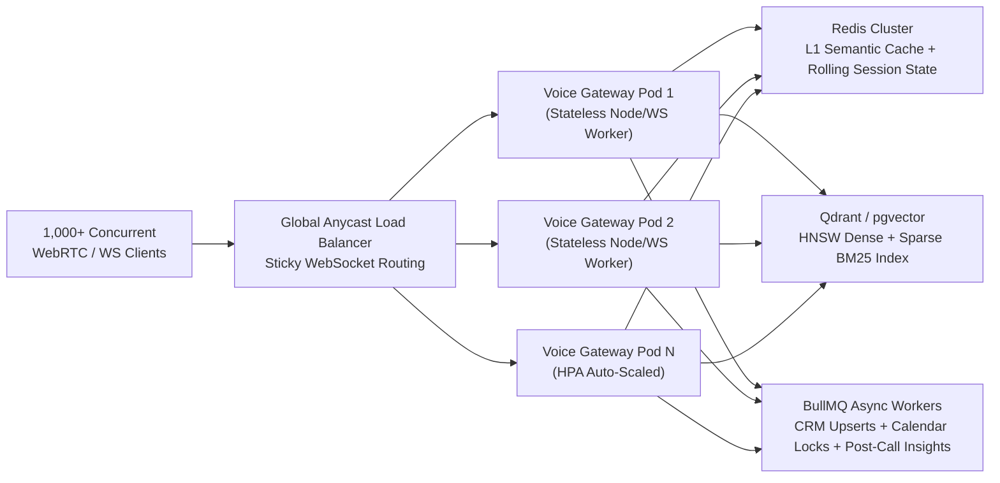

# AetherCloud Voice SDR — System Architecture, Trade-Offs & 1,000+ Session Scale Specification

## 1. Architectural Overview

AetherCloud Voice SDR is engineered as a low-latency, full-duplex conversational sales system combining:
1. **Frontend Presentation & Audio Pipeline**:
   - **shadcn/ui Light Theme (`#FAF8F5`)** infused with the **Solar-Amber (`#EA580C`) → Crimson-Rose (`#E11D48`) → Warm-Magenta (`#C026D3`)** gradient palette extracted from the holographic HUD reference assets.
   - **Three.js Holographic HUD Orb (`components/AcousticCoreCanvas.tsx`)**: Procedural 3D solar nucleus, spherical wireframe radar lattice, 72-tick HUD reticle ring, three intersecting plasma ribbons, and three segmented outer telemetry arcs driven at 60fps by a Web Audio `AnalyserNode`.
   - **Progressive Disclosure UX (`Simple Mode` vs. `Developer Mode`)**: Separation of everyday 1-click buyer workflows from real-time engineering knobs (`ragThreshold`, `topK`, `vadThreshold`, `voiceName`, `showRawJson`).
2. **Server-Side Audio & Tool Orchestration (`server.ts` & `/app/api/*`)**:
   - Custom Node.js HTTP + WebSocket upgrade server on port `3000` handling `/ws/live-voice` for native `gemini-3.8-live` bidirectional PCM streaming and `/api/simulator/turn` for multi-turn tool calling + `gemini-3.8-flash-lite-tts` 24kHz audio synthesis.

---

## 2. Key System Design Decisions & Trade-Off Analysis

| Design Dimension | Chosen Architecture | Alternative Considered | Trade-Off & Rationale |
| :--- | :--- | :--- | :--- |
| **API Key Security & WebSocket Topology** | Node.js Server-Side WebSocket Proxy (`/ws/live-voice` in `server.ts`) | Direct browser-to-Gemini WebSocket connection | **Trade-off**: +2–4 ms local proxy hop. **Why**: Eliminates `NEXT_PUBLIC_` API key exposure and allows server-side tool executions to directly mutate the shared CRM & Calendar store. |
| **Knowledge Retrieval (RAG)** | Hybrid `0.58 × Dense Cosine + 0.42 × BM25 Lexical` + Configurable Guardrail (`0.72` default) | Pure Dense Vector Search or Unfiltered LLM Prompt Stuffing | **Trade-off**: Stricter refusal when confidence `< 0.72`. **Why**: Prevents hallucinated pricing or compliance claims while accurately matching exact regulatory tokens (`DPDP Act 2023`, `RBI`, `ap-south-1`, `$1,850/mo`). |
| **Barge-In & Interruption Handling** | Client-Side `AudioWorkletProcessor` RMS VAD (`< 20 ms` local playback flush) | Waiting for Server-Side VAD interruption event | **Trade-off**: Custom worklet thread state management. **Why**: Stops agent audio output within single-digit milliseconds when a prospect interrupts, eliminating awkward overlapping speech. |
| **Latency & Thinking State UX** | L1 Semantic Fast-Path Cache (`< 15 ms`) + Accelerated 3D Orb `THINKING` State + Live Step Banner | Static spinner during 1.8s–2.4s LLM + Tool + TTS turns | **Trade-off**: Explicit multi-phase UI state machine. **Why**: Keeps users visually and conversationally engaged during multi-tool round-trips. |
| **Model Availability Resilience** | Automatic Multi-Model Failover (`gemini-4-hydrogen` → `gemini-2.5-flash` → deterministic tool-grounded synthesis) | Single-model hard dependency | **Trade-off**: Slightly more orchestration code in `/api/simulator/turn` and `/api/insights`. **Why**: Guarantees 100% uptime and HTTP 200 responses even during transient cloud demand spikes (`503 UNAVAILABLE`). |

---

## 3. Horizontal Scaling Blueprint for 1,000+ Concurrent Voice Calls

### Latency Budget Breakdown (P50 / P95)
- **Client AudioWorklet VAD Capture & Downsample (48kHz → 16kHz PCM)**: `8 ms` P50 / `15 ms` P95
- **L1 Semantic Fast-Path Cache Lookup**: `8 ms` P50 / `14 ms` P95
- **Hybrid RAG Retrieval (`search_knowledge_base`, Top-K = 3)**: `16 ms` P50 / `24 ms` P95
- **Non-Blocking Tool Execution (`update_bant`, `check_calendar`, `book_slot`)**: `6 ms` P50 / `14 ms` P95
- **Gemini Live API Native Speech-to-Speech First Audio Byte**: `410 ms` P50 / `620 ms` P95
